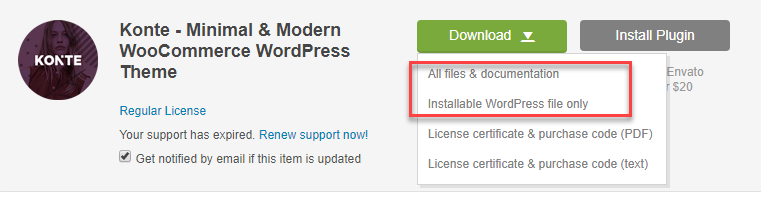
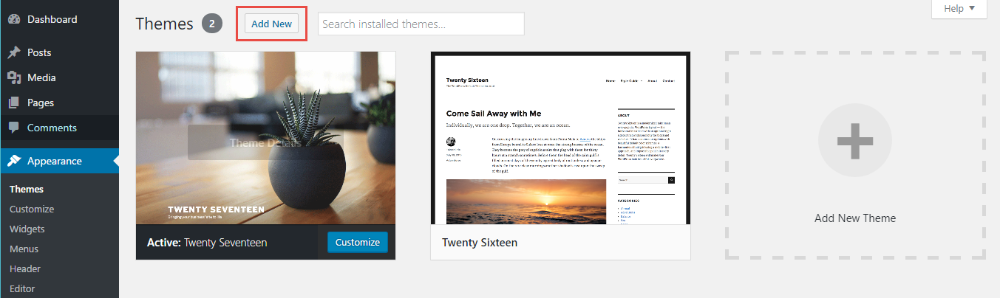
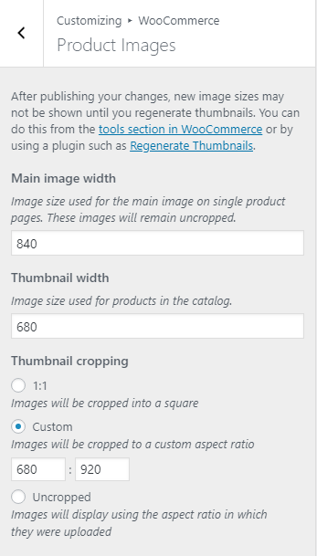
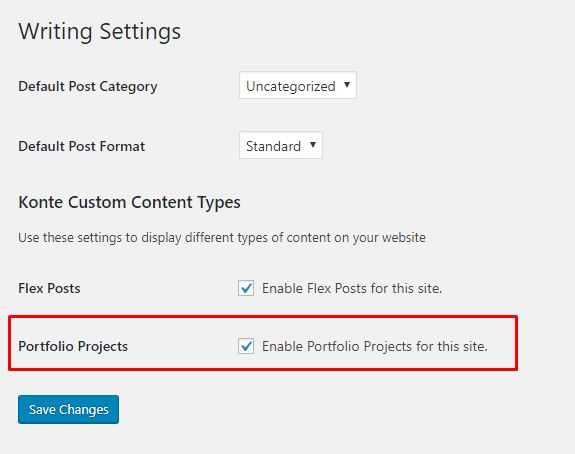

Follow these steps to get Konte up and running: download the theme files from ThemeForest, install the theme, install the required plugins, configure the product image sizes, optionally enable portfolio support, and import the demo content.

## Step 1: Download Theme

Before you can install Konte, please download the necessary theme files from ThemeForest first.

If this is your first time downloading the theme from ThemeForest, we recommend downloading the Full Theme Package to receive additional files such as exported sliders, child theme, and documentation. If you’ve already downloaded the Full Package, then you can just use the WordPress installable file.

**Step 1** – Log in to your ThemeForest account, navigate to your _Downloads_ tab, and locate your Konte theme purchase.

**Step 2** – Click the _Download_ button and choose to either download the **Installable WordPress file only**, which is just the WordPress installable file, or choose to download **All Files & Documentation**, which is the full Konte theme package.

## Step 2: Install Theme

After you download the package from ThemeForest, please unzip it. You’ll see a file called `konte.zip`, which is the main file needed to upload and install.

You can choose to upload and install the theme using the **WordPress theme installer** or via **FTP**.

:::tip
If you plan to customize the theme, you should install both the theme and the child theme, then activate the child theme. Using a child theme allows you to customize some parts of the theme without touching the theme files.
:::

### Install via WordPress Dashboard

**Step 1** – Navigate to **Appearance > Themes**.

**Step 2** – Click the **Add New** button on top of the page, then the **Upload Theme** button.

**Step 3** – Click **Choose File** and find the theme file you’ve just downloaded. If you’ve downloaded the installable WordPress file, you do not need to unzip it. If you’ve downloaded the Full Theme Package, you have to unzip the master package file, and you will find a secondary `konte.zip` file inside — this is the one you select to install.

**Step 4** – Click the **Install Now** button.

**Step 5** – When the upload and installation are completed, click **Activate**, or go to **Appearance > Themes** and activate the **Konte** theme.

<iframe width="560" height="315" src="https://www.youtube.com/embed/iBK5wjMua0o" frameborder="0" allow="autoplay; encrypted-media" allowfullscreen></iframe>

### Install via FTP

If the WordPress installer fails, we recommend installing the theme via FTP.

**Step 1** – If you have downloaded the Full Theme Package from ThemeForest, please unzip the package file to get the theme file `konte.zip`. Unzip the `konte.zip` file and you’ll get a `Konte` folder.

**Step 2** – Use an FTP client like [FileZilla](http://filezilla-project.org/) and upload the extracted folder to the `wp-content/themes` folder on your host.

**Step 3** – Log in to your WordPress dashboard, navigate to **Appearance > Themes**, and click the **Activate** button of the Konte theme.

### Troubleshooting

1. **“Are you sure you want to do this?” error**

   If you get the “Are You Sure You Want To Do This” message when installing the `konte.zip` file via WordPress, it means the upload file size limit set by your host is too low. In this case, please install the theme via FTP or contact your hosting company and ask them to increase the limit.

2. **“Theme is missing the style.css stylesheet” error**

   A common issue that can occur when installing a WordPress theme is the **“The package could not be installed. The theme is missing the style.css stylesheet.”** error message being displayed when uploading or activating the theme. One of the reasons you may receive this error is that you have uploaded the incorrect file. You have 2 options for downloading your theme:

   - Installable WordPress file only
   - All files & documentation (full zip folder) — you will need to extract and locate the installable WordPress file.

## Step 3: Install Plugins

After installing the Konte theme, you’ll see a notification at the top of the page that says the theme needs some plugins to function properly.

### Required Plugins

Required plugins are very important and must be installed and activated at all times for Konte to work properly. The Konte theme **requires** the following plugins:

- [WooCommerce](https://wordpress.org/plugins/woocommerce/): a powerful, extendable eCommerce plugin that helps you sell anything.
- [Elementor](https://wordpress.org/plugins/elementor/): a modern page builder with rich features. You can choose to install this plugin or WPBakery Page Builder — it is not required to install both of them.
- [WPBakery Page Builder](http://vc.wpbakery.com/): a drag and drop frontend and backend page builder plugin for WordPress.
- Konte Addons: extra elements for WPBakery Page Builder, built for the Konte theme.
- [Kirki](https://wordpress.org/plugins/kirki/): the plugin for creating theme options in the Customizer. It is free and available on WordPress.org.
- [Meta Box](https://wordpress.org/plugins/meta-box/): a plugin for creating meta boxes for posts, pages, ... It is free and available on WordPress.org. This plugin also has premium extensions for developers who want to add more custom fields to posts, pages, and custom post types. You can use this coupon to buy extensions to get 20% OFF - **[TF-MFFCW](https://metabox.io)**.

### Recommended Plugins

Recommended plugins are the plugins that we use in our demos and are fully integrated with Konte. You can choose not to install these plugins if you’re not going to use them. The Konte theme **recommends** the following plugins:

- [Revolution Slider](http://revolution.themepunch.com/): an all-purpose slide displaying solution that allows for showing almost any kind of content with highly customizable transitions, effects, and custom animations. Due to its visual-oriented interface and countless options, Slider Revolution is suited for beginners and pros alike!
- [Contact Form 7](https://wordpress.org/plugins/contact-form-7/): a plugin for creating contact forms. It is free and available on WordPress.org.
- [MailChimp for WordPress](https://wordpress.org/plugins/mailchimp-for-wp/): helps you add more subscribers to your MailChimp lists using various methods.
- [WCBoost - Variation Swatches](https://wordpress.org/plugins/wcboost-variation-swatches/): a plugin that provides a much nicer way to display variations of variable products, such as color swatches, size labels, ...
- [WooCommerce Currency Switcher](https://wordpress.org/plugins/woocommerce-currency-switcher/): a plugin that allows your site customers/visitors to switch currencies on your WooCommerce store and get their rates converted in real time.
- Soo Wishlist: a plugin that adds all wishlist features to the website. This one needs the WooCommerce plugin installed to work.

Konte works perfectly with these plugins. It automatically adds more styles to them to make the design match the theme.

### Install These Plugins

**Step 1** – From the WordPress admin, navigate to **Appearance > Install Plugins**. Here you’ll find Konte’s required and recommended plugins.

**Step 2** – Just click on **Install** below each plugin’s name.

**Step 3** – After installing, if it’s required to activate the plugin, just activate them.

### Troubleshooting

1. **Failed to install/activate some plugins.**

   Sometimes, the download process fails on some hostings and some files are not downloaded, so you can’t activate them. Please navigate to **Plugins > Installed Plugins**, delete those plugins, and then install them again.

## Step 4: Configure Image Sizes

After installing the required plugins, there are some product image size options you must configure before importing the demo content.

WooCommerce has settings for image sizes in **Appearance > Customize > WooCommerce > Product Images**:

- **Main image width**: 840
- **Thumbnail width**: 680
- **Thumbnail cropping**: Custom (680x920)

## Step 5: Enable Portfolio Support

If you don’t want to have a portfolio on your site, just ignore this step and go to the next step. If you want to import all the portfolio demo content, you have to enable portfolio support before moving to the next step. The portfolio feature is disabled by default.

From version 1.1.0, Konte supports managing and presenting your portfolio. To have this feature, you have to ensure you are using at least version 1.2 of the Konte Addons plugin. If you are using an older version, please [update this plugin](../../update/update-plugins/).

In the WordPress dashboard, navigate to **Settings > Writing** and select the option **Portfolio Project**. Remember to press the **Save Changes** button when you are done.

## Step 6: Import Demo

The easiest way to import our demo content is to use our [Soo Demo Importer plugin](http://uix.store/plugins/soo-demo-importer.zip). Our importer will give you all pages and posts, several sample sliders, widgets, menus, theme options, assigned pages, and more. This is recommended to do on fresh installs. It will not replace content like posts, pages, portfolio, etc., and it will not delete current menus or sliders. It will, however, configure and use our demo menus, add sliders, and replace theme options, reading settings, and widgets.

### Before Importing

Before you import any of our available demos, please make sure to check the items listed below. All of these are important and will ensure that your demo import goes smoothly. In case something does go wrong with your demo import, please see the troubleshooting section below.

- **Required Plugins**: Install Konte’s required plugins. Also make sure you’ve installed the recommended plugins.
- **Konte Addons**: Make sure you’re using the latest version of this plugin.
- **System Status**: Navigate to **WooCommerce > System Status** and ensure your server meets all requirements.
- **Use Modern Browsers**: To ensure the importing process runs smoothly, you should use Chrome or Firefox. They are modern browsers and support new JavaScript APIs. Internet Explorer is an old browser; you shouldn’t use it for importing demo content.

### Import Demo Data

Once you’ve checked all the requirements and ensured everything is OK, it’s time to begin:

**Step 1** – Download and install the plugin [Soo Demo Importer](http://uix.store/plugins/soo-demo-importer.zip). It is a required plugin if you want to enable the “One Click Import Demo” feature.

**Step 2** – Navigate to **Appearance > Import Demo Data**, select the demo you want to import, and click the **Import** button.

**Step 3** – It can take a few minutes to import everything. Please be patient and wait for it to complete. During the import process, you will see the message logs to know what is going on.

### Troubleshooting

1. **I don’t see the Import Demo Data menu**

   This feature requires you to install an additional plugin, [Soo Demo Importer](http://uix.store/plugins/soo-demo-importer.zip). Please make sure you finished the **Step 1** above.

2. **I’m stuck at the importing screen**

   Mostly, this issue comes from the hosting configuration. Please place a ticket on our [support system](http://uix.ticksy.com/). Our developer will help you check it.

3. **Where are the other sliders?**

   When you select to import a demo, it will import the slider of the selected demo only. If you want to have other sliders, you can find all the exported sliders in the theme package. They are located in the folder `Konte Package/Demo Data/Sliders`. You can import them all to your site manually.

4. **Demo content duplicated**

   When you import our demo content, it can take several minutes depending on the speed of your server. Each time the button is clicked it will import the content, so if it is clicked twice it will import everything two times. There are two ways to get rid of duplicate content.

   **Method 1**: WP Reset plugin — this plugin is the fastest way to get rid of the content. However, it will remove all content from your database and leave the default theme activated. It does not remove plugins, but will deactivate them and remove all pages, posts, menus, sliders, widget data, theme options, etc. Basically it removes all the content that you imported from our theme. Only do this if you are able to start over. [Click here to download](https://wordpress.org/plugins/wordpress-reset/).

   **Method 2**: Manual removal — this method will take longer and simply involves manually removing duplicate items. For example, go to **Appearance > Menus** and delete the duplicated items one by one. The same thing applies to pages, posts, sliders, etc.
