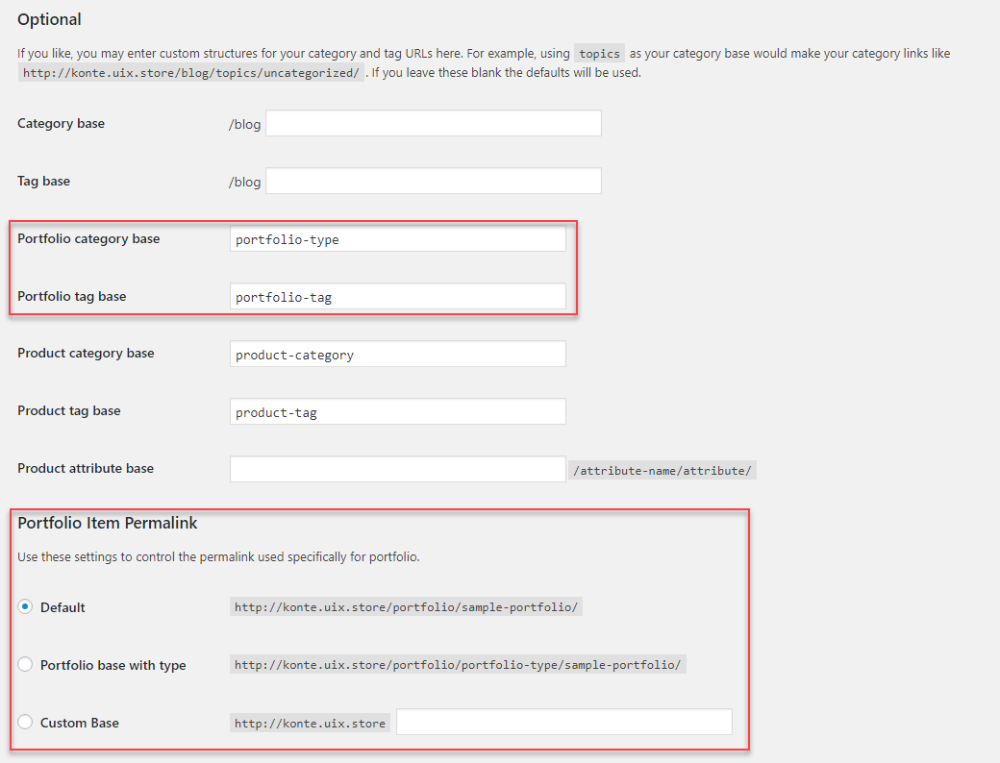

Konte Addons plugin allows you to change the permalinks of Portfolio and project pages as you want. To do this, you can go to **Settings > Permalinks**. Besides default settings of WordPress and WooCommerce, you will see new options for Portfolio there.

