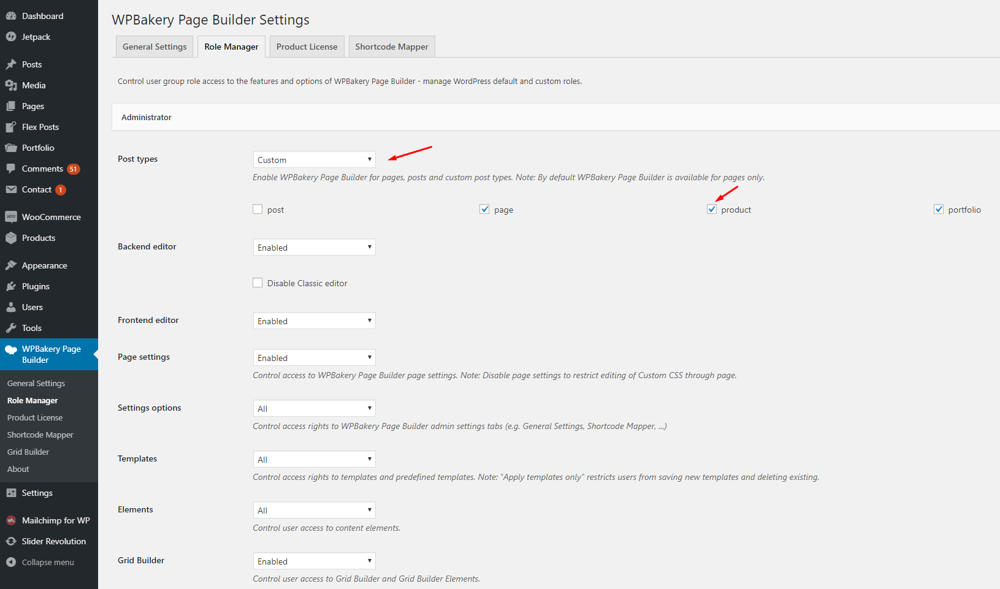

To enable the WPBakery Page Builder for your custom post types, simply go to WPBakery Page Builder > Role Manager and under the user role you want to set the post types for you, select "Custom" from the dropdown then check all the post types you want to use the page builder on.

