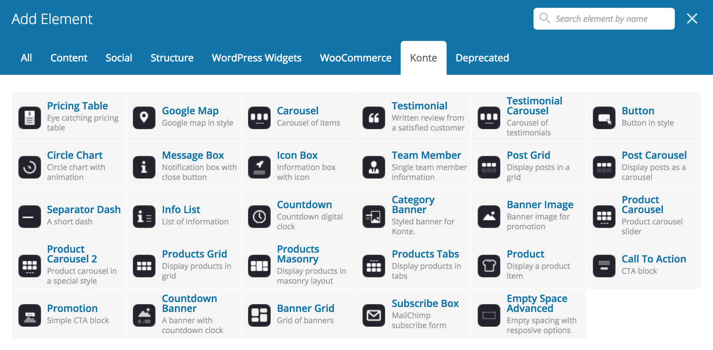

It has a very simple and intuitive interface, but before getting started, you may find it useful to get accustomed with its documentation:

[WPBakery Page Builder Documentation](https://kb.wpbakery.com/)

In Konte, we also create some new elements that will help you build your website a lot easier.

